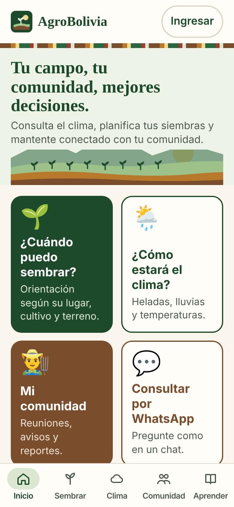
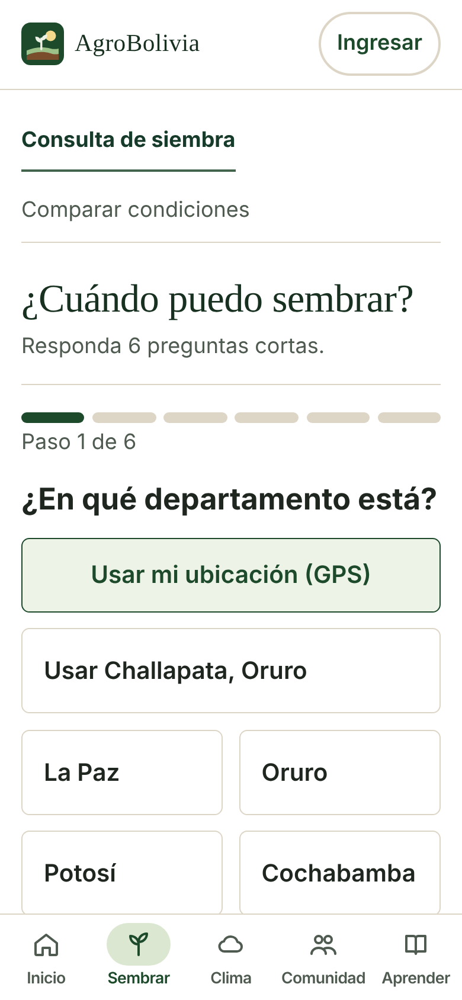
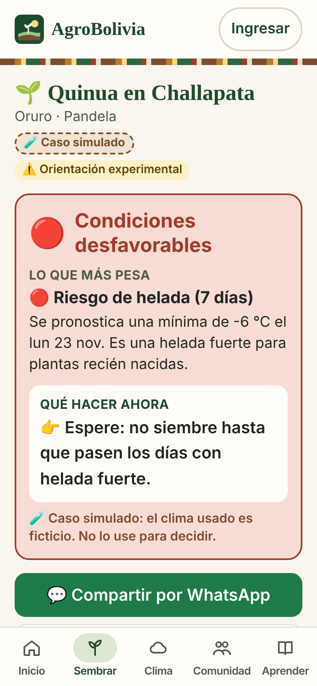
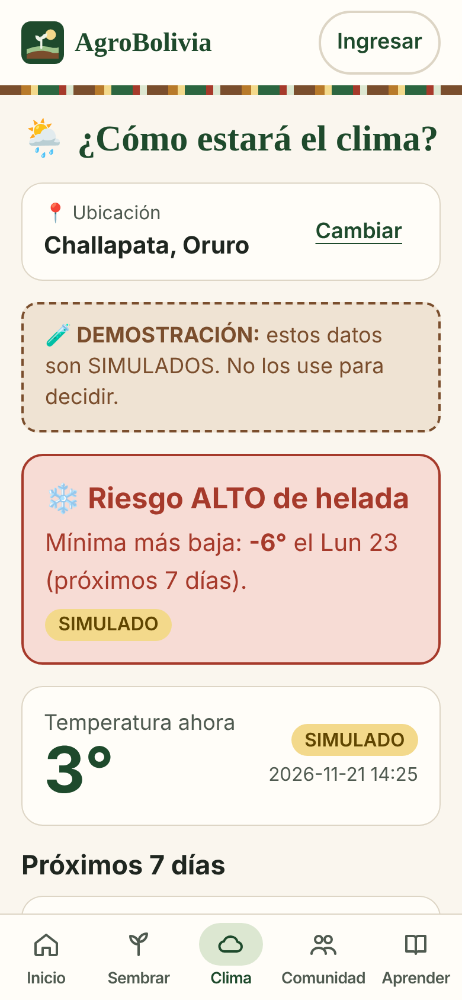

# AgroBolivia 🌱

**Plataforma inteligente de asistencia agroclimática y comunicación comunitaria para agricultores de Bolivia.**

> *Tu campo, tu comunidad, mejores decisiones.*

Prototipo funcional para hackatón universitaria. Integra los tracks **Comunicación** (comunidades, reuniones, avisos, reportes y WhatsApp) y **Educación** (lecciones breves para interpretar el clima y reducir riesgos).

| Inicio | Asistente de siembra | Resultado explicable | Clima (demostración) |
|---|---|---|---|
|  |  |  |  |

## Qué funciona hoy

| Función | Estado |
|---|---|
| Página principal con 4 acciones visibles sin desplazarse (probado en 360×740) | ✅ |
| Caso de demostración «Probar con quinua en Challapata» (sin cuenta, datos simulados) | ✅ |
| Selección de departamento → municipio → cultivo (9 departamentos, 32 municipios) | ✅ |
| Clima: pronóstico **Open-Meteo**, historial y climatología **NASA POWER**, riesgo de helada, tormentas | ✅ datos reales (con caché y respaldo) |
| Recomendación de siembra explicable 🟢🟡🔴⚪ con factor decisivo y acción principal | ✅ **Quinua en el Altiplano** (Oruro, Potosí, La Paz) · 🧪 Papa y Maíz en modo *demostración* · ⚪ Haba y Cebada sin reglas |
| Registro e inicio de sesión de agricultores (celular + clave) | ✅ |
| Comunidades con aprobación del administrador; solicitudes de unión aprobadas por el representante | ✅ |
| Reuniones, confirmación de asistencia, avisos, reportes de helada/granizo, historial | ✅ |
| Panel de administración: comunidades, permisos, usuarios, reportes | ✅ |
| Asistente de WhatsApp | 🧪 **SIMULADOR** (no conectado). Arquitectura y webhook oficial listos para credenciales |
| Módulo educativo "Aprendamos sobre nuestro campo" (7 lecciones con preguntas y fuentes) | ✅ español · quechua/aimara pendientes de revisión lingüística |
| Avisos regionales segmentados (nacional, departamento, municipio o cultivo), publicados por administradores o editores, con vigencia y etiqueta *no oficial* | ✅ |
| Cultivos de interés en el perfil (filtran los avisos que recibe cada persona) | ✅ |
| Biblioteca filtrable por cultivo, tipo y departamento (8 guías con nota de fuente) | ✅ |
| Cobertura nacional (mapa de municipios y qué hay en cada departamento), privacidad y términos | ✅ |
| Adaptador para fuente meteorológica oficial con contrato normalizado | ✅ listo; se activa con `OFFICIAL_WEATHER_URL` |
| Avisos oficiales SENAMHI | ❌ no integrados (ver [docs/FUENTES_DATOS.md](docs/FUENTES_DATOS.md)); se enlaza al sitio oficial |

Nada se presenta como algo que no es: los datos **simulados**, las **observaciones comunitarias**, los **datos ingresados por el agricultor** y los **pronósticos** llevan etiquetas distintas en la interfaz y en la API.

## Ejecutar (5 minutos)

Requisitos: Python 3.11+ y Node.js 18+.

```bash
cd backend && python -m venv .venv && .venv/bin/pip install -r requirements-dev.txt && cp .env.example .env
```

Edite `backend/.env` (al menos `SECRET_KEY` y `ADMIN_PASSWORD`). Luego compile el frontend:

```bash
cd frontend && npm install && npm run build
```

Y arranque todo en un solo proceso (la API sirve también la web compilada):

```bash
cd backend && .venv/bin/uvicorn app.main:app --port 8000
```

Abra <http://localhost:8000>. Documentación interactiva de la API: <http://localhost:8000/docs>.

Para desarrollar con recarga en caliente, deje el backend corriendo y en otra terminal:

```bash
cd frontend && npm run dev
```

(Vite en <http://localhost:5173> redirige `/api` al backend.)

### Cuentas de demostración (ficticias, `SEED_DEMO=true`)

| Rol | Celular | Clave |
|---|---|---|
| Representante (Comunidad Demo Challapata) | 70000001 | demo1234 |
| Agricultora | 70000002 | demo1234 |
| Administrador | el de `ADMIN_PHONE` | el de `ADMIN_PASSWORD` |

### Demo de 2 minutos: productora de quinua en Challapata

Caso: una productora de Challapata (Oruro) quiere saber si es buen momento para sembrar quinua y avisar a su comunidad. No hace falta cuenta ni internet hacia los proveedores de clima: el caso usa **datos simulados** y lo dice en pantalla.

1. **Abrir el caso (≈20 s).** En el Inicio, baje un poco y toque **«▶ Probar con quinua en Challapata»** (etiqueta *🧪 Caso simulado*). Se abre el resultado ya calculado para Oruro → Challapata → Quinua Pandela → suelo húmedo → depende de la lluvia. También se abre directo con `/#/sembrar/demo`.
2. **Explicar el factor principal (≈60 s).** Sin desplazarse, la primera pantalla muestra:
   - el **estado** con color, emoji y texto (p. ej. 🔴 *Condiciones desfavorables*);
   - **Lo que más pesa**: el criterio decisivo y por qué (p. ej. *Riesgo de helada: mínima de −6 °C el lun 23 nov*);
   - **Qué hacer ahora**: una sola acción sencilla (p. ej. *Espere: no siembre hasta que pasen los días con helada fuerte*).
   Más abajo: *Confianza · ¿qué significa?* (explica que no es una probabilidad), la lista **Todos los factores** con su fuente y tipo de dato, y la aclaración de que las reglas son **experimentales y pendientes de validación agronómica**.
3. **Mostrar el mensaje listo para compartir (≈30 s).** Toque **«Ver el mensaje que se enviará»**: incluye cultivo, municipio, resultado, factor principal, acción, **«Caso simulado»** y **«Orientación experimental»**. **«💬 Compartir por WhatsApp»** abre WhatsApp para que *la persona* elija a quién enviarlo; el asistente automático de AgroBolivia en WhatsApp sigue siendo un **simulador**.
4. **Cierre (≈10 s).** «Consultar con datos reales» repite la misma consulta con Open-Meteo y NASA POWER; si el pronóstico no está disponible, la app lo dice y baja la confianza.

> El resultado simulado es reproducible durante el día (no depende de la red), pero cambia con la fecha: las fechas del pronóstico simulado y el calendario de siembra avanzan. Ensaye la demo el mismo día de la presentación.

### Guion completo (≈4 min)
1. **Inicio → ¿Cuándo puedo sembrar?** Oruro → Challapata → Quinua → Pandela → Sí, húmedo → Depende de la lluvia. Resultado en 7 toques, con el *porqué* de cada criterio y su fuente.
2. **Clima**: pronóstico real, riesgo de helada, historial NASA POWER, enlace a SENAMHI. Si el pronóstico no responde, se ve el mensaje claro y el botón "Ver demostración" (etiquetado SIMULADO).
3. **Comunidad** (representante 70000001): convocar reunión → "Recordar" (genera recordatorios *simulados* solo para quienes aceptaron WhatsApp).
4. **WhatsApp** (agricultora 70000002): "¿Cuándo es la reunión de mi comunidad?" → "SI" → la asistencia se registra. "Quiero avisar que cayó granizo en mi zona." → queda como *observación comunitaria*.
5. **Aprender**: lección "¿Qué es una helada?" con pregunta.

## Desplegar

- **Render (recomendado):** *New + → Blueprint* → elegir este repositorio. `render.yaml` crea el servicio (Docker) y la base PostgreSQL; solo pide `ADMIN_PHONE` y `ADMIN_PASSWORD`.
- **Vercel (alternativa):** ya configurado con `vercel.json` y `api/index.py`; requiere conectar PostgreSQL (Neon).

Guía paso a paso de ambos: [docs/DESPLIEGUE.md](docs/DESPLIEGUE.md).

## Pruebas

```bash
cd backend && .venv/bin/python -m pytest
```

```bash
cd frontend && npm test
```

```bash
node e2e/run.cjs http://localhost:8000
```

Resultados actuales: **84/84** backend, **7/7** unitarias frontend, **20/20** extremo a extremo (también contra PostgreSQL actualizado desde la versión anterior). GitHub Actions ejecuta backend, frontend y build en cada push a `main` (`.github/workflows/ci.yml`). Detalle en [docs/PRUEBAS.md](docs/PRUEBAS.md).

## Documentación

- [docs/ARQUITECTURA.md](docs/ARQUITECTURA.md) — arquitectura, justificación tecnológica, mapa de navegación, pantallas, seguridad.
- [docs/ALGORITMO.md](docs/ALGORITMO.md) — motor de recomendación, criterios, pesos y umbrales experimentales.
- [docs/FUENTES_DATOS.md](docs/FUENTES_DATOS.md) — evaluación de SENAMHI, NASA POWER y Open-Meteo.
- [docs/WHATSAPP.md](docs/WHATSAPP.md) — integración oficial, consentimiento, plantillas, costos y pasos para conectar.
- [docs/PRUEBAS.md](docs/PRUEBAS.md) — casos de prueba y resultados.
- [docs/DESPLIEGUE.md](docs/DESPLIEGUE.md) — despliegue en Render (recomendado) o Vercel.
- [docs/LIMITACIONES.md](docs/LIMITACIONES.md) — lo que el prototipo **no** hace todavía.

## Créditos

Varias funciones se adaptaron del proyecto hermano **PACHAAGRO** ([Z0M3I/PACHAAGRO](https://github.com/Z0M3I/PACHAAGRO), licencia MIT, © 2026 Z0M3I): segmentación de avisos por alcance, cultivos de interés, biblioteca y sus guías, contrato de fuente meteorológica oficial, comandos y plantillas de WhatsApp, registro de estados de entrega, páginas de privacidad y términos, cobertura nacional, manifiesto web y CI. Se reescribieron para React + FastAPI; no se copió código de Next.js ni de Supabase.

## Aviso

Prototipo académico. Las orientaciones de siembra usan reglas y umbrales **experimentales, no validados agronómicamente**. No reemplazan a un técnico agrícola ni los avisos oficiales del SENAMHI. No se realizaron pruebas con usuarios reales ni existen métricas de impacto.
